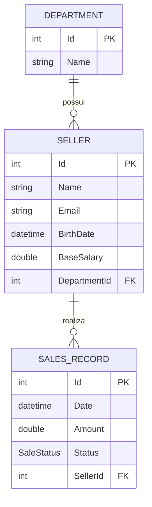
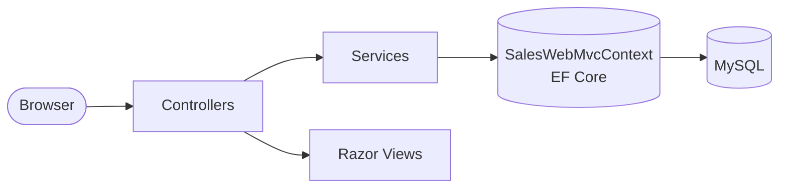

<div align="center">

# 🛒 SalesWebMvc

**Sistema web de gestão de vendas — departamentos, vendedores e registros de venda.**

Projeto legado em ASP.NET Core MVC desenvolvido no curso *C# COMPLETO — Programação Orientada a Objetos + Projetos*.


</div>

---

## 📑 Sumário

- [Funcionalidades](#-funcionalidades)
- [Stack](#-stack)
- [Modelo de domínio](#-modelo-de-domínio)
- [Arquitetura](#-arquitetura)
- [Como rodar](#-como-rodar)
- [Rotas principais](#-rotas-principais)
- [Estrutura de pastas](#-estrutura-de-pastas)
- [Dados de exemplo](#-dados-de-exemplo)

---

## ✨ Funcionalidades

| Módulo | Recursos |
| --- | --- |
| 🏢 **Departamentos** | CRUD completo (scaffolding) |
| 👤 **Vendedores** | CRUD completo, validação de formulário, seleção de departamento |
| 💰 **Vendas** | Busca simples e busca agrupada por departamento, filtro por intervalo de datas |

Destaques técnicos:

- ⚡ Operações **assíncronas** (`async`/`await`) na camada de serviço
- ✅ Validação com **Data Annotations** (client + server side)
- 🛡️ Tratamento de exceções customizadas: `NotFoundException`, `IntegrityException`, `DbConcurrencyException`
- 🔒 Proteção **anti-forgery** nos formulários `POST`
- 🌱 **Seed automático** do banco em ambiente `Development`
- 🌎 Cultura fixa `en-US` para formatação de números e datas

---

## 🧰 Stack

- **Runtime:** .NET Core 2.1
- **Web:** ASP.NET Core MVC + Razor Views
- **ORM:** Entity Framework Core 2.1 (Code First + Migrations)
- **Banco:** MySQL via `Pomelo.EntityFrameworkCore.MySql`
- **Front-end:** Bootstrap, jQuery, jQuery Validation

---

## 🧩 Modelo de domínio



`SaleStatus`: `Pending` (0) · `Billed` (1) · `Canceled` (2)

Regras de negócio:

- `Seller.TotalSales(initial, final)` soma as vendas do vendedor no período.
- `Department.TotalSales(initial, final)` soma o total de todos os vendedores do departamento.
- Vendedor com vendas associadas **não pode ser excluído** (integridade referencial).
- Nome do vendedor: 3–60 caracteres · Salário base: 100,00–50.000,00.

---

## 🏗️ Arquitetura



- **Controllers** — recebem requisições e orquestram views
- **Services** — regras de acesso a dados e exceções de domínio
- **Data** — `DbContext` e `SeedingService`
- **Models** — entidades, enums e view models

---

## 🚀 Como rodar

### Pré-requisitos

- [.NET Core SDK 2.1](https://dotnet.microsoft.com/download/dotnet/2.1) (runtime `Microsoft.AspNetCore.App 2.1.x`)
- [MySQL Server](https://dev.mysql.com/downloads/mysql/) rodando em `localhost:3306`

### 1. Clonar

```bash
git clone git@github.com:Atanazio01/sales-web-mvc-legacy.git
cd sales-web-mvc-legacy
```

### 2. Configurar conexão

Ajuste a connection string em `SalesWebMvc/appsettings.json`:

```json
"ConnectionStrings": {
  "SalesWebMvcContext": "server=localhost;userid=root;password=1234;database=saleswebmvcappdb"
}
```

### 3. Criar o banco

No **Package Manager Console** do Visual Studio:

```powershell
Update-Database
```

### 4. Executar

```bash
dotnet run --project SalesWebMvc/SalesWebMvc.csproj --launch-profile SalesWebMvc
```

Acesse 👉 **https://localhost:5001** ou **http://localhost:5000**

> 💡 No Windows, se o MySQL estiver instalado como serviço e parado, inicie como administrador:
> `Start-Service MySQL96`

---

## 🗺️ Rotas principais

| Rota | Descrição |
| --- | --- |
| `/` | Página inicial |
| `/Departments` | Lista e CRUD de departamentos |
| `/Sellers` | Lista e CRUD de vendedores |
| `/SalesRecords` | Menu de buscas de vendas |
| `/SalesRecords/SimpleSearch?minDate=&maxDate=` | Vendas no período |
| `/SalesRecords/GroupingSearch?minDate=&maxDate=` | Vendas no período agrupadas por departamento |

---

## 📂 Estrutura de pastas

```
SalesWebMvc/
├── Controllers/        # Departments, Sellers, SalesRecords, Home
├── Data/               # SalesWebMvcContext, SeedingService
├── Migrations/         # Migrations do EF Core
├── Models/
│   ├── Enums/          # SaleStatus
│   └── ViewModels/     # SellerFormViewModel, ErrorViewModel
├── Services/
│   └── Exceptions/     # NotFound, Integrity, DbConcurrency
├── Views/              # Razor views por controller
├── wwwroot/            # CSS, JS e libs (Bootstrap, jQuery)
├── Startup.cs
└── Program.cs
```

---

## 🌱 Dados de exemplo

Em ambiente `Development`, o `SeedingService` popula o banco vazio com:

- **4** departamentos — Computers, Electronics, Fashion, Books
- **6** vendedores
- **30** registros de venda (set–out/2018)

---

<div align="center">

Feito com ☕ e C# durante o curso de POO do Udemy.

</div>
